<!--
  root@cadush:~$ cat README.md
  Assets animados em ./assets (SVG puro, sem JS, respeitam prefers-reduced-motion).
-->

<a href="https://cadush.github.io">
  
</a>

<p align="center">
  <a href="https://www.linkedin.com/in/cadush/"></a>
  <a href="https://cadush.github.io"></a>
  <a href="https://tryhackme.com/p/c.sh"></a>
  <a href="mailto:carloseduardosh04@gmail.com"></a>
  
</p>

<br>



```yaml
# ~/.config/cadush/profile.yml
name:      Carlos Eduardo Pacheco dos Santos
role:      Analista de Segurança da Informação @ Catálise Investimentos
location:  Curitiba, PR — Brasil
focus:     [pentest, appsec, cloud-security, detection-engineering, incident-response]
stack:     [siem, soar, edr, iam, zero-trust, sse/ztna]
research:  [reverse-engineering, malware-analysis, osint]
education: Segurança da Informação — Uniasselvi (2027)
languages: { pt-BR: native, en: intermediate }
learning:  [LPI-101, "(ISC)² CC"]
ask_me:    [pentest, appsec, siem/soar, cloud-security, linux, networking]
```

> Defendo como quem ataca e ataco como quem defende.
> Construo detecção, automatizo resposta e quebro aplicações antes que alguém de fora o faça.

<br>



```diff
@@ 2026-07 → HEAD @@  Catálise Investimentos · Analista de Segurança da Informação
+ Arquitetura e operação de controles de rede, identidade, endpoint e acesso remoto
+ Fortigate · Netskope SSE/ZTNA · Microsoft Security
+ Pentest, auditorias e AppSec

@@ 2025-11 → 2026-06 @@  Econet Editora Empresarial · Analista de Suporte/Segurança
+ SIEM corporativo Wazuh na AWS: 4.500+ regras, 28 técnicas MITRE ATT&CK, 26 ativos monitorados
+ SOAR (Shuffle + TheHive + Cortex) com bloqueio automático de IPs maliciosos
+ Pentests Black Box e Gray Box no portal, na infraestrutura AWS e em APIs corporativas
+ Governança: Comitê de Segurança, políticas, standards e portal de gestão de credenciais
+ Monitoramento com Zabbix e Cloud Security

@@ 2025-05 → 2025-11 @@  AEON Technologies · Analista de TI Jr II
+ Servidores Linux e Windows
+ Firewalls pfSense, Sophos e Fortinet · VPNs
+ Wazuh, PingCastle e OpenVAS
```

<br>



<table>
  <tr>
    <td width="170"><code>offensive</code></td>
    <td>
      
      
      
      
      
      
    </td>
  </tr>
  <tr>
    <td><code>detection</code></td>
    <td>
      
      
      
      
      
      
    </td>
  </tr>
  <tr>
    <td><code>response</code></td>
    <td>
      
      
      
      
    </td>
  </tr>
  <tr>
    <td><code>endpoint</code></td>
    <td>
      
      
      
    </td>
  </tr>
  <tr>
    <td><code>network · zt</code></td>
    <td>
      
      
      
      
      
      
    </td>
  </tr>
  <tr>
    <td><code>cloud · iam</code></td>
    <td>
      
      
      
      
    </td>
  </tr>
  <tr>
    <td><code>appsec</code></td>
    <td>
      
      
      
      
      
      
    </td>
  </tr>
  <tr>
    <td><code>forensics · re</code></td>
    <td>
      
      
      
    </td>
  </tr>
  <tr>
    <td><code>vuln mgmt</code></td>
    <td>
      
      
    </td>
  </tr>
  <tr>
    <td><code>lang</code></td>
    <td>
      
      
      
      
    </td>
  </tr>
  <tr>
    <td><code>infra</code></td>
    <td>
      
      
      
      
      
      
    </td>
  </tr>
</table>

<br>



| issuer | credential | year |
|:--|:--|:--:|
| `Fortinet` | **FCP — FortiSIEM 7.2 Analyst** | 2025 |
| `Fortinet` | **FCP — FortiSOAR 7.3 Administrator** | 2025 |
| `Fortinet` | NSE 1 · NSE 2 · NSE 3 | 2025 |
| `CyberWarFare Labs` | **Certified Red Team Analyst (CRTA)** | 2026 |
| `CyberWarFare Labs` | **Multi-Cloud Red Team Analyst** | 2026 |
| `CyberWarFare Labs` | **Multi-Cloud Blue Team Analyst** | 2026 |
| `Cisco` | CCNP Enterprise: Core Networking | 2025 |
| `Cisco` | Ethical Hacker | 2025 |
| `Cisco` | Analista de Segurança Jr | 2025 |
| `SkillFront` | ISO/IEC 27001:2022 | 2025 |

<sub>Credenciais verificáveis em <a href="https://www.linkedin.com/in/cadush/details/certifications/">linkedin.com/in/cadush/details/certifications</a></sub>

<br><br>



<p align="center">
  <a href="https://github.com/Cadush/SECops">
    <picture>
      <source media="(prefers-color-scheme: dark)" srcset="https://github-readme-stats.vercel.app/api/pin/?username=Cadush&repo=SECops&theme=chartreuse-dark&hide_border=true&bg_color=0d1117&title_color=00ff41&icon_color=00ff41"/>
      
    </picture>
  </a>
  <a href="https://github.com/Cadush/Dump_Memory">
    <picture>
      <source media="(prefers-color-scheme: dark)" srcset="https://github-readme-stats.vercel.app/api/pin/?username=Cadush&repo=Dump_Memory&theme=chartreuse-dark&hide_border=true&bg_color=0d1117&title_color=00ff41&icon_color=00ff41"/>
      
    </picture>
  </a>
</p>

| repo | o que faz | stack |
|:--|:--|:--|
| [`SECops`](https://github.com/Cadush/SECops) | **APPSEC-SECops Automation**: orquestra SAST, SCA, secrets scanning, container security, DAST e vulnerability management num único pipeline | `devsecops` |
| [`Dump_Memory`](https://github.com/Cadush/Dump_Memory) | Aquisição forense de memória em Linux sem dependências externas: imagem comprimida, hashes de custódia, índice de segmentos e relatório | `go` `dfir` |
| [`LFIHUNTER`](https://github.com/Cadush/LFIHUNTER) | Detecção e validação de LFI com evidência clara e menos falsos positivos | `python` `pentest` |
| [`Fail2ban-Monitor`](https://github.com/Cadush/Fail2ban-Monitor) | Painel em tempo real para Fail2Ban: IPs banidos, padrões de ataque e gestão de bans pelo terminal | `python` `blue-team` |
| [`Calculadora_Redes`](https://github.com/Cadush/Calculadora_Redes) | Calculadora de sub-redes IPv4 com interface Rich no terminal | `python` `net` |
| [`SCAN_REDE`](https://github.com/Cadush/SCAN_REDE) | Varredura de rede local: hosts ativos, IP, MAC, hostname e serviços | `bash` `recon` |
| [`imapsync_Migracao`](https://github.com/Cadush/imapsync_Migracao) | Migração segura de caixas entre servidores IMAP | `bash` `infra` |
| [`Backup`](https://github.com/Cadush/Backup) | Backups automatizados em Linux com rsync e cron, com foco em integridade | `bash` `infra` |

<br>



```text
 ┌─────────┐    ┌─────────┐    ┌─────────┐    ┌─────────┐    ┌──────────┐    ┌─────────┐
 │  RECON  │───▶│ EXPLOIT │───▶│ REPORT  │───▶│ DETECT  │───▶│ AUTOMATE │───▶│ HARDEN  │
 └─────────┘    └─────────┘    └─────────┘    └─────────┘    └──────────┘    └────┬────┘
      ▲                                                                           │
      └──────────────────────────────── feedback loop ◀───────────────────────────┘

  red     pentest black/gray box em web, APIs e AWS
  blue    detecções mapeadas no MITRE ATT&CK + SOAR que responde sozinho
  purple  todo achado de pentest vira regra de detecção e playbook
  grc     políticas, standards, comitê de segurança, ISO/IEC 27001
```

<br>



<p align="center">
  <picture>
    <source media="(prefers-color-scheme: dark)" srcset="https://github-readme-stats.vercel.app/api?username=Cadush&show_icons=true&include_all_commits=true&count_private=true&theme=chartreuse-dark&hide_border=true&bg_color=0d1117&title_color=00ff41&icon_color=00ff41"/>
    
  </picture>
  <picture>
    <source media="(prefers-color-scheme: dark)" srcset="https://github-readme-stats.vercel.app/api/top-langs/?username=Cadush&layout=compact&langs_count=8&theme=chartreuse-dark&hide_border=true&bg_color=0d1117&title_color=00ff41"/>
    
  </picture>
</p>

<p align="center">
  <picture>
    <source media="(prefers-color-scheme: dark)" srcset="https://github-readme-activity-graph.vercel.app/graph?username=Cadush&bg_color=0d1117&color=8b949e&line=00ff41&point=e6edf3&area=true&area_color=00ff41&hide_border=true"/>
    
  </picture>
</p>

<p align="center">
  <a href="https://tryhackme.com/p/c.sh">
    
  </a>
</p>

<br>



```console
root@cadush:~$ ./connect.sh --all
[+] linkedin    linkedin.com/in/cadush
[+] web         cadush.github.io
[+] github      github.com/Cadush
[+] tryhackme   tryhackme.com/p/c.sh
[+] mail        carloseduardosh04@gmail.com
[*] handshake complete — vamos conversar sobre segurança.
```

<a href="https://cadush.github.io">
  
</a>
